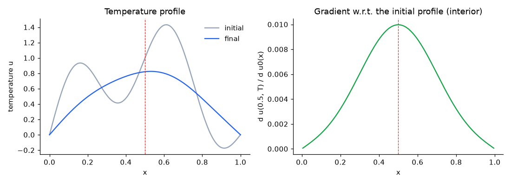

# Heat Equation Sample

Solves the 1D heat equation with an explicit finite-difference scheme over many
time steps and computes, in one adjoint pass, the gradient of the final
temperature at the midpoint with respect to the whole initial temperature
profile. XAD's checkpointing keeps the tape memory bounded however many time
steps are taken.

## Problem

The temperature $u(x, t)$ on $x \in [0, 1]$ follows

    du/dt = alpha * d^2u/dx^2

with both end points held at their initial temperature. On a grid of
$N_x = 201$ points, each explicit time step updates the interior points as

    u_i <- u_i + lambda * (u_{i+1} - 2 u_i + u_{i-1}),    lambda = alpha * dt / dx^2 = 0.4

which is stable for $\lambda \le 0.5$. The sample takes 2,000 time steps from
the initial profile $u_0(x) = \sin(\pi x) + 0.5 \sin(4 \pi x)$, and the output is
the temperature at the midpoint, $y = u(0.5, T)$.

The adjoint pass gives $\partial y / \partial u_0(x_i)$ for all 201 grid points
at once.

## Checkpointing

Recording all 2,000 time steps on the tape takes about 21 MiB, and this grows
linearly with the number of time steps. With checkpointing
(`heat_checkpoint.hpp`), the time steps are run in stages of 50:

- In the forward pass, `HeatCheckpointCallback::computeStage` runs a stage with
  plain `double`, so nothing of it is recorded, stores the profile at the start
  of the stage, and inserts itself into the tape with `insertCallback`.
- In the adjoint pass, XAD calls `computeAdjoint` for each stage in reverse
  order. It reads the adjoints of the stage outputs with
  `getAndResetOutputAdjoint`, re-runs the stage from its checkpoint in a nested
  recording (`ScopedNestedRecording`), and passes the adjoints back to the stage
  inputs with `incrementAdjoint`.

Only one stage is on the tape at any time, so the peak tape memory drops from
about 21 MiB to about 0.6 MiB, plus about 0.1 MiB for the stored profiles. The
sample prints both, and checks that the gradients with and without
checkpointing agree.

## Checks

- The gradients with and without checkpointing agree to $10^{-12}$.
- Five gradient entries agree with central finite differences to $10^{-8}$.
- The peak tape memory with checkpointing is below the memory without it.

If any check fails, the sample exits with a non-zero code, so `ctest` catches
regressions.

## Gradient Profile

The sample writes `heat_gradient.csv` with the columns `x`, `initial`, `final`
and `gradient`. The gradient is the discrete heat kernel centred at the
midpoint: the final midpoint temperature depends most on the initial
temperature nearby, and less on points further away.

The gradient entries at the two end points (not plotted) are larger, since the
end points are held fixed and feed into their neighbours at every time step.

## Build and Run

From the repository root:

    cmake -S . -B build
    cmake --build build --target HeatEquation
    build/samples/HeatEquation/HeatEquation

Or run via `ctest`:

    ctest --test-dir build -R sample_HeatEquation --output-on-failure

## Expected Output

    1D heat equation: 201 grid points, 2000 explicit time steps, lambda = 0.4
    Objective: temperature at x = 0.5 at the final time

    u(0.5, T) = 0.8208640529

    Tape memory without checkpointing:   21778.2 KiB
    Tape memory with checkpointing (every 50 steps):
      after the forward pass:                8.1 KiB
      peak during the adjoint pass:        566.4 KiB
      plus checkpoint storage:              94.2 KiB

    Largest difference with / without checkpointing: 3.47e-18

       index           adjoint      finite diff.  abs. diff.
          20  1.2393454311e-03  1.2393454307e-03    3.60e-13
          70  7.5272677210e-03  7.5272677214e-03    4.00e-13
         100  9.9723931361e-03  9.9723931357e-03    3.93e-13
         120  8.8007336897e-03  8.8007336907e-03    1.01e-12
         180  1.2393454311e-03  1.2393454324e-03    1.31e-12

    Gradient profile written to heat_gradient.csv

Memory figures can differ slightly with the build options.
